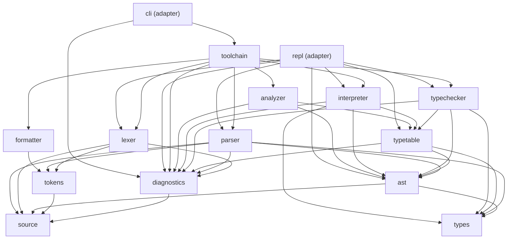
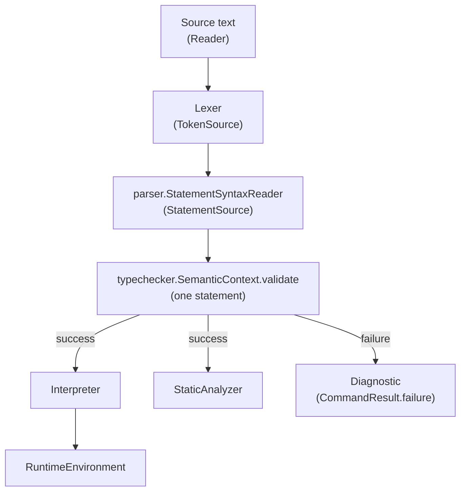
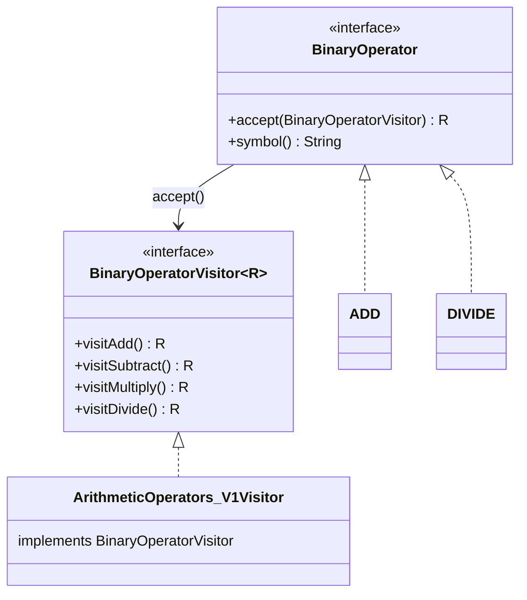

# PrintScript Architecture

This document is the entrypoint for the architecture notes. Start at the [root README](../README.md)
for build/run instructions and a quick module index; come here for the design rules and the module
dependency graph that don't fit a one-line summary.

PrintScript should be built as a small language core surrounded by replaceable interaction adapters. The current adapters are the CLI and the REPL, but the core must not depend on either's concepts. Future adapters could be a REST API, editor plugin, web UI, Gradle plugin, or language server.

## Architecture Notes

- [Source Module](../source/ARCHITECTURE.md)
- [Diagnostics Module](../diagnostics/ARCHITECTURE.md)
- [Tokens Module](../tokens/ARCHITECTURE.md)
- [Lexer Module](../lexer/ARCHITECTURE.md)
- [Types Module](../types/ARCHITECTURE.md)
- [AST Module](../ast/ARCHITECTURE.md)
- [Parser Module](../parser/ARCHITECTURE.md)
- [Typetable Module](../typetable/ARCHITECTURE.md)
- [Typechecker Module](../typechecker/ARCHITECTURE.md)
- [Interpreter Module](../interpreter/ARCHITECTURE.md)
- [Formatter Module](../formatter/ARCHITECTURE.md)
- [Analyzer Module](../analyzer/ARCHITECTURE.md)
- [Toolchain Module](../toolchain/ARCHITECTURE.md)
- [CLI Module](../cli/ARCHITECTURE.md)
- [REPL Module](../repl/ARCHITECTURE.md)
- [Testkit Module](../testkit/ARCHITECTURE.md)

See also [findings-review.md](findings-review.md) for known, not-yet-fixed inconsistencies between
some of these modules' `build.gradle`/`module-info.java` descriptors.

## Module dependency graph

Each arrow is a `requires` in that module's `module-info.java`, which is also the only place main
dependencies are declared: the `org.gradlex.java-module-dependencies` plugin (applied in
`settings.gradle`) derives every Gradle dependency from those directives, so this graph and the build
cannot drift apart. Every arrow is a direct use: a module `requires` exactly the modules it imports
from, never relying on one reached transitively.

`cli` is the only module allowed to depend on `toolchain`; every other module below it is part of
the language core and must stay adapter-agnostic. `cli --> diagnostics` is the one
edge that reaches past `toolchain`, and it's a deliberate exception, not a leak: `Diagnostic` is
zero-dependency, stable, shared vocabulary (the same category as an error/result type in any
API) — `CommandResult.diagnostics()` returns it, so anything that renders *why* an operation failed
needs the type in scope. `cli` used to also depend on `interpreter` directly, just to supply
`InputPort`/`EnvironmentPort` lambdas for interactive `readInput`/`readEnv`; those are now
`toolchain`'s own `InputSource`/`EnvironmentSource` ports (mirroring `ProgressReporter`), adapted
internally, so that edge is gone.

`repl` is a second adapter that deliberately does *not* depend on `toolchain`: `toolchain.PrintScript`
only exposes whole-program operations, with no way to get a `SemanticContext`/`RuntimeEnvironment`
back out between statements, which a REPL needs. Rather than growing `toolchain` a REPL-specific
stateful API, `repl` is its own thin composition root straight over the language core, the same way
`toolchain` itself is — see [REPL Module](../repl/ARCHITECTURE.md).

Notice `lexer` and `parser` both depend on `tokens` but never on each other — that's deliberate,
see [Tokens Module](../tokens/ARCHITECTURE.md). The same reasoning splits `parser` out of `ast`,
`typechecker` out of `typetable`, and `types` out of `ast`: `interpreter`/`analyzer`
walk the AST `ast` defines and read a `SemanticModel`, but none of them build a tree or run the
checker that produces one. `types` has zero dependencies — pure vocabulary, no tree or stream
shape attached.

## Pipeline data flow

What actually happens when `toolchain.PrintScript` runs a command, for the statements that make it
through validation. Formatting skips the parser entirely: `PrintScriptFormatter` reads the lexer's
token stream, trivia included, and never validates; see
[Formatter Module](../formatter/ARCHITECTURE.md).

## Recurring pattern: interface-with-singletons + visitor

Eight otherwise-unrelated "closed set of kinds" types across the codebase follow the same shape, so
it's documented once here instead of eight times: `tokens.TokenType`, `lexer.Punctuation`,
`types.TypeName`, `interpreter.RuntimeValue`, `analyzer.NamingStyle`,
`toolchain.LanguageVersion`, and the AST's `ast.nodes.expressions.BinaryOperator` and
`ast.nodes.expressions.ExpressionSyntax` / `ast.nodes.statements.StatementSyntax`. Each is
modeled as an interface with one singleton constant (or sealed subtype) per kind and an
`accept(XVisitor<R>)` method, rather than a Java `enum` with a `switch`.

The payoff: adding a new kind (e.g. a new `BinaryOperator` constant) forces a compile error in every
`XVisitor` implementation across every module that dispatches on it — `interpreter.ArithmeticOperators`
for operators, `formatter.SpacingRules` for a new `TokenType`, and any future one — until every case
is handled. A `switch` over an `enum` only gets that same exhaustiveness check if every call site
remembers to write one.

## Main Direction

- Keep the language core independent from interaction layers.
- Process source code statement by statement.
- Use immutable values wherever practical.
- Surface user-code problems as structured diagnostics.
- Keep side effects behind ports.
- Route version-specific behavior through factories.
- Pipeline stages communicate through pull-based port interfaces (`TokenSource`, `StatementSource`)
  owned by the module that defines the value they stream, not through each other's concrete
  implementation classes. A stage's build.gradle/module-info dependency should point at the module
  that owns the contract it consumes, never at the module that happens to produce it today.

## Design Rules

- AST is for language meaning.
- Token trivia (whitespace and comments) is for formatting and comment preservation; the formatter
  works on tokens, never on a tree.
- Parser recovery is not part of the current design; commands stop at the first syntax error.
- Runtime errors stop execution immediately.
- Variables require explicit type annotations.
- Numbers use decimal semantics.
- Config files use JSON, read through the `toolchain.PrintScriptConfigReader` port (`cli` wires
  in the production `JsonPrintScriptConfigReader`); the core config types (`FormatterConfig`,
  `AnalyzerConfig`) are not coupled to any particular file format.
- No single "common" grab-bag module: shared vocabulary is split by cohesion (`source`,
  `diagnostics`, `tokens`) so a module only depends on the specific concept it actually uses.
  Orchestration-only types (`CommandResult`, `LanguageVersion`, `ProgressReporter`) live in
  `toolchain`, the only place that uses them, rather than in a shared foundation module.
